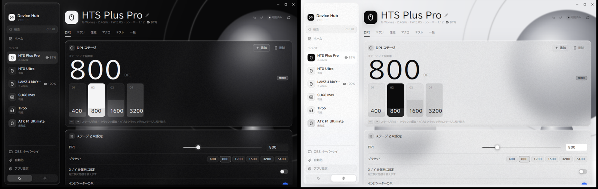
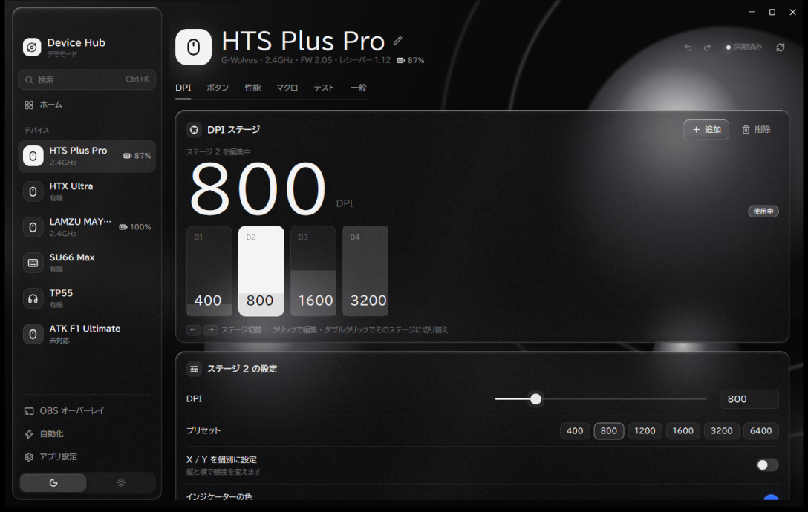
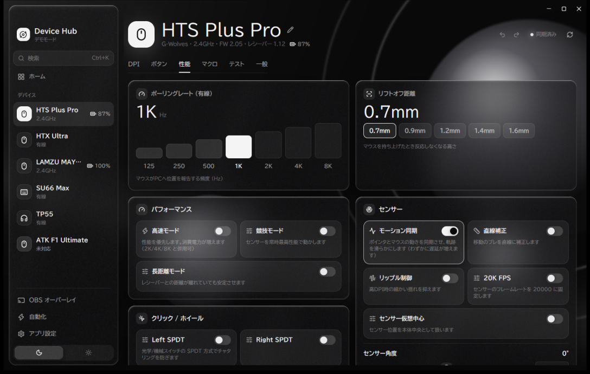
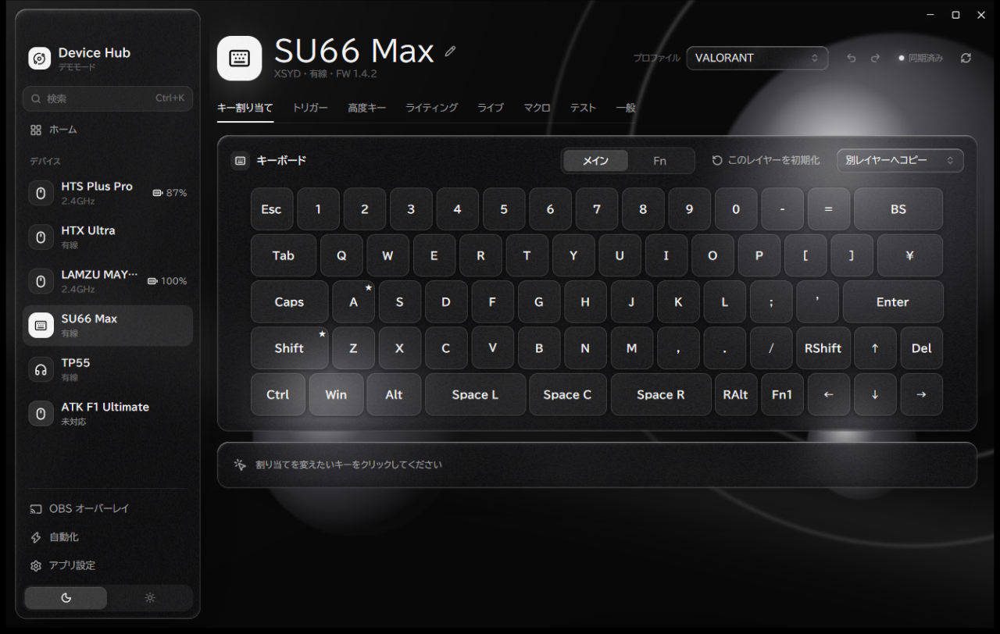
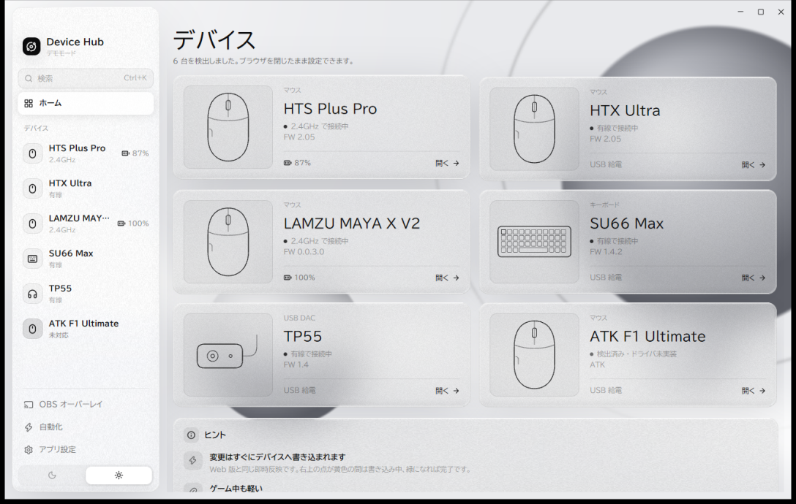
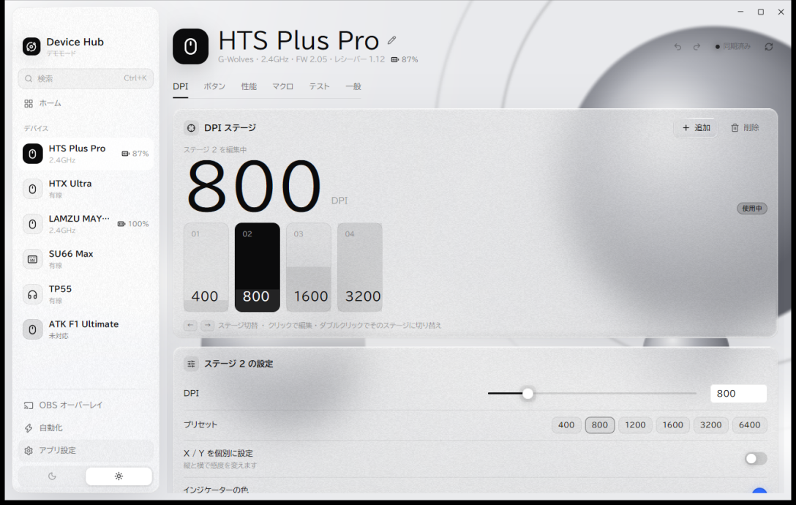
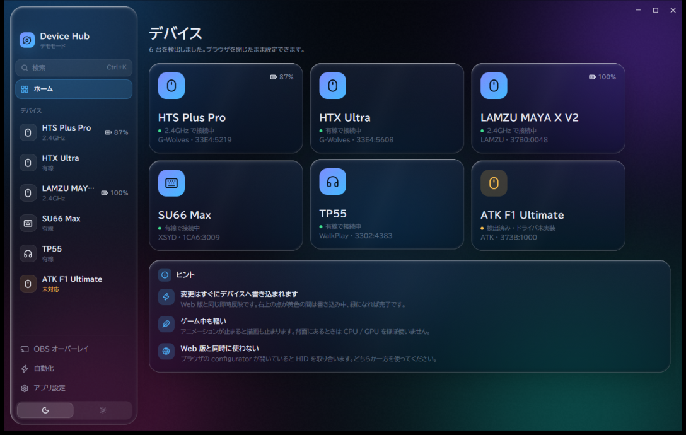

# Device HUB

**マウス・磁気スイッチキーボード・USB DAC を、ブラウザを開き続けずに設定する Windows ネイティブアプリです。**

**[English](README.md)** | **日本語**

[](https://github.com/pity-zxcv/device-hub/releases/latest)
[](https://github.com/pity-zxcv/device-hub/actions/workflows/ci.yml)
[](LICENSE-MIT)



Device HUB は HID でデバイスと直接通信します。画面はドライバが返す **caps** (`Capabilities` / `SettingSpec` / `ActionSpec`) から自動生成されるので、新しい機種のドライバを足せば、通常の設定画面を UI 側に書かなくても使えます。

## できること

| | |
|---|---|
| **マウス** | DPI ステージ、ポーリングレート、LOD、モーション設定、デバウンス、スリープ、ボタン割り当て、マクロ、磁気ボタン校正、電池・無線スリープ表示 |
| **磁気キーボード** | キーマップと本体レイヤー、キーごとの押下点、Rapid Trigger、デッドゾーン、ライティング、高度キー、マクロ、校正、押下深さのライブ表示 |
| **USB DAC** | 対応 DAC のパラメトリック EQ 編集 |
| **自動化** | 前面アプリの exe に連動したプロファイル、インポート/エクスポート、プリセット、元に戻す、コマンドパレット |
| **配信・計測** | OBS 押下深さオーバーレイ、USB ポーリングレート計測 |
| **デスクトップ統合** | トレイ常駐、元に戻せる Windows 自動起動、多重起動防止、ファームウェア/アプリ更新確認 |
| **デザイン** | Frost Graphite / Liquid Glass、dark/light、モーション調整 |

<p>



</p>
<p>



</p>

## すぐ使う

1. [Releases](https://github.com/pity-zxcv/device-hub/releases/latest) から Windows 用 ZIP をダウンロードします。
2. 展開して `device-hub.exe` を起動します。
3. SmartScreen が出た場合は、ダウンロード元のリリースを確認したうえで **詳細情報 → 実行** を選びます。

インストール、USB 計測、OBS 配信の詳しい手順は [docs/QUICKSTART_JA.md](docs/QUICKSTART_JA.md) にあります。

Web 設定ツールやベンダーアプリと同時には使わないでください。HID デバイスを複数の書き込み側で安全に共有できません。

## 検証済みデバイス

「検証済み」は実機でその経路の読み書きを確認した意味です。同じプロトコルの機種は UI を機種名で分岐せず caps で自動検出しますが、未検証機種は実験扱いです。

| デバイス | 状態 |
|---|---|
| HTS Plus Pro (有線 + 2.4GHz ドングル) | 全設定、DPI、ボタン、マクロ、ポーリング 125–8K、磁気ボタン校正/押下深さ、休眠/復帰を検証 |
| HTX Ultra 3950 (有線) | 設定読み書き、SPDT、ポーリング、LOD、DPI、ボタン、マクロを検証 |
| SU66 Max | キーマップ、ライティング、キーごと性能、ポーリング、OS/デバウンス/スリープ、構成、高度キー、マクロ、live travel、校正を検証 |
| ATK F1 V3 ULTIMATE+ (有線 + ドングル) | FW/電池、DPI/ステージ色、ポーリング、LOD、モーション、デバウンス、スリープ、ボタン、プロファイル、工場リセットを検証 |
| TP55 / WalkPlay USB DAC | パラメトリック EQ の読み書きを検証 |
| LAMZU MAYA X V2 | プロトコル実装あり。一部未検証/未対応。詳細: [docs/LAMZU_MAYA_X_V2_AUDIT2.md](docs/LAMZU_MAYA_X_V2_AUDIT2.md) |

## あなたのデバイスを追加しよう

このプロジェクトの中心は、「自分のデバイスのプロトコルを自分で解析してドライバを足す」ことです。本家がすべての機種を持っているわけではありません。caps 駆動の UI なので、ドライバさえ書けば設定画面は自動でできます。

```text
メーカーの WebHID ツール / USB キャプチャ
        ↓ まず読み取りだけ解析
docs/PROTOCOL_NOTES.md → crates/devhub-hid driver → registry 登録
        ↓
Capabilities + SettingSpec + ActionSpec
        ↓
ネイティブ UI が自動で出る → 実機で往復確認 → PR
```

手順は [docs/ADD_DEVICE.md](docs/ADD_DEVICE.md)、解析例は [docs/PROTOCOL_NOTES.md](docs/PROTOCOL_NOTES.md)。

安全の約束:

- 最初は読み取り専用で解析し、ファームウェア更新・DFU は扱わない。
- 読み書き読みの往復が分かるまで書き込まない。
- ベンダーアプリや Web 版と同時に HID を開かない。
- 解析元のライセンスと出どころを [THIRD_PARTY_NOTICES.md](THIRD_PARTY_NOTICES.md) に書く。

フォークでは Logitech HID++、Razer、MCHOSE、MonsGeek などの追加が進んでいます。重複を減らすため実機確認済み driver の PR を歓迎します。[CONTRIBUTING.md](CONTRIBUTING.md) を参照してください。

## リポジトリ構成

| Path | 役割 |
|---|---|
| `crates/devhub-core` | 契約 v2、keys、registry、demo backend |
| `crates/devhub-hid` | 実機 HID ドライバ |
| `crates/devhub-polling` | USBPcap ポーリング計測 |
| `crates/devhub-obs` | OBS ソースプラグイン |
| `crates/devhub-update` | ファームウェア/アプリ更新確認 |
| `crates/device-hub` | GPUI デスクトップアプリ |

## ビルド

```sh
cargo run --release -p device-hub
DEVHUB_DEMO=1 cargo run -p device-hub
DEVHUB_FAST=1 cargo run -p device-hub
cargo test --workspace
cargo clippy --workspace --locked -- -D warnings
```

Windows x64、Rust 1.95.0 (`rust-toolchain.toml`) です。

## ライセンスと注意

MIT OR Apache-2.0。第三者情報は [THIRD_PARTY_NOTICES.md](THIRD_PARTY_NOTICES.md)。Device HUB は非公式で、各デバイスメーカーとは関係ありません。
