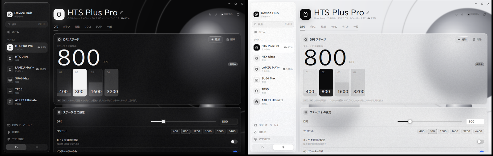
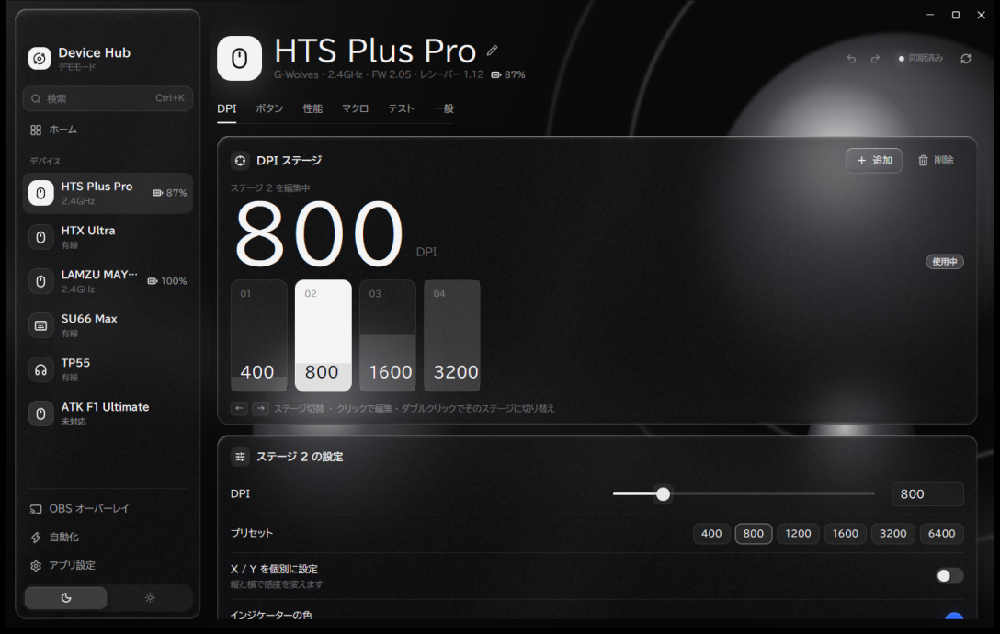
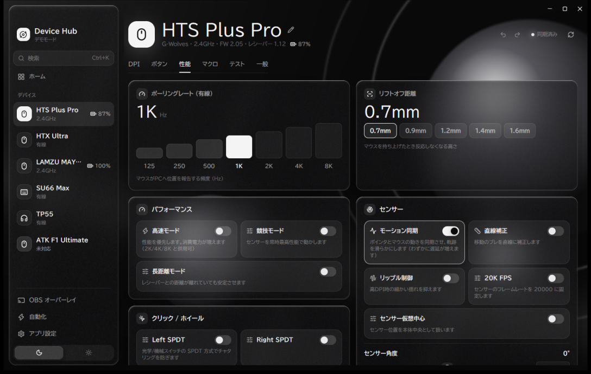
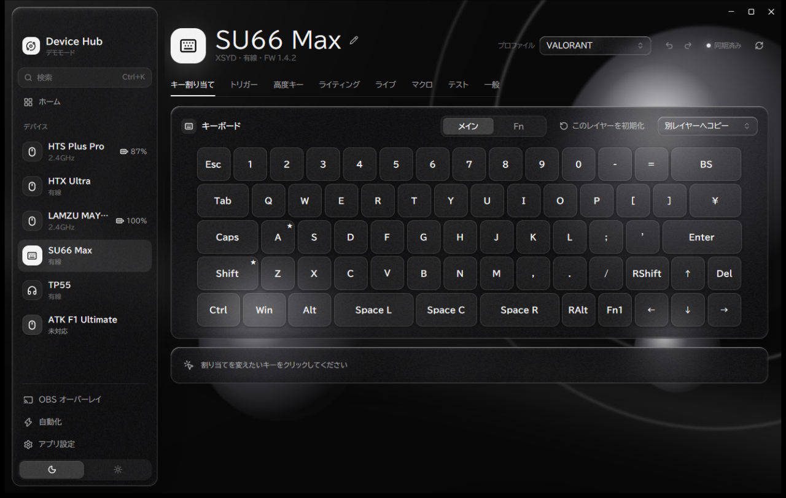
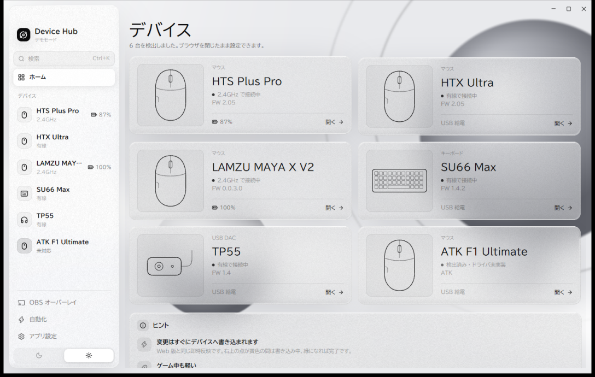
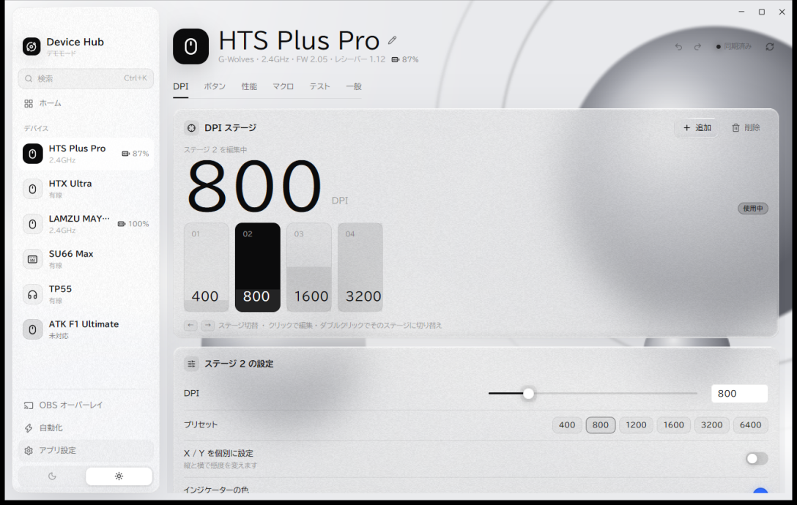
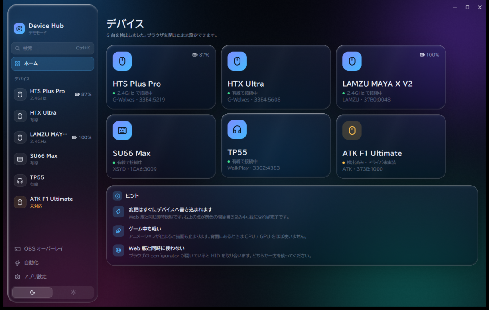

# Device HUB

**A native Windows configurator for gaming mice, magnetic-switch keyboards, and USB DACs — without keeping a browser open.**

[](https://github.com/pity-zxcv/device-hub/releases/latest)
[](https://github.com/pity-zxcv/device-hub/actions/workflows/ci.yml)
[](LICENSE-MIT)



Device HUB talks to devices directly over HID. The interface is generated from each driver's declared **capabilities** (`Capabilities`, `SettingSpec`, `ActionSpec`), so a new device driver automatically receives a polished native UI — no page or widget code is required for ordinary settings.

**English** | **[日本語](README.ja.md)** ・ 日本語クイックスタート: [docs/QUICKSTART_JA.md](docs/QUICKSTART_JA.md)

## What it can do

| | |
|---|---|
| **Mice** | DPI stages, polling rate, LOD, motion options, debounce, sleep, button remapping, macros, Hall-effect button calibration, battery and wireless sleep state |
| **Magnetic keyboards** | Keymap and onboard layers, per-key actuation, rapid trigger, deadzones, lighting, advanced keys, macros, calibration, live travel depth |
| **USB DACs** | Parametric EQ editing for supported DACs |
| **Automation** | Per-application profiles selected by foreground executable, import/export, presets, undo, command palette |
| **Streaming and measurement** | OBS press-depth overlay plugin and USB polling-rate measurement |
| **Desktop integration** | Tray residency, reversible Windows logon autostart, single-instance activation, firmware/app update checks |
| **Design** | Frost Graphite and Liquid Glass themes, dark/light, adjustable motion |

<p>



</p>
<p>



</p>

## Use it

1. Download the Windows ZIP from [Releases](https://github.com/pity-zxcv/device-hub/releases/latest).
2. Extract it and run `device-hub.exe`.
3. If Windows SmartScreen appears, choose **More info → Run anyway** after checking the release you downloaded.

Japanese installation, USB measurement, and OBS instructions: [docs/QUICKSTART_JA.md](docs/QUICKSTART_JA.md).

No browser configurator or vendor application should be open at the same time: HID devices cannot be safely shared by multiple writers.

## Verified devices

“Verified” means the listed path was exercised against real hardware. Devices using the same protocol are still detected through capabilities rather than by hard-coded UI names, but unverified models should be treated as experimental.

| Device | Status |
|---|---|
| HTS Plus Pro — wired and 2.4 GHz dongle | Verified: settings, DPI, buttons, macros, polling 125–8K, magnetic-button calibration/travel, sleep/wake handling |
| HTX Ultra 3950 — wired | Verified: settings read/write, SPDT, polling, LOD, DPI, buttons, macros |
| SU66 Max | Verified: keymap, lighting, per-key performance, polling, OS/debounce/sleep, configurations, advanced keys, macros, live travel, calibration |
| ATK F1 V3 ULTIMATE+ — wired and dongle | Verified: firmware/battery, DPI/stage colors, polling, LOD, motion options, debounce, sleep, button keys, profiles, factory reset |
| TP55 / WalkPlay USB DAC | Verified: parametric EQ read/write |
| LAMZU MAYA X V2 | Protocol implementation present; see [docs/LAMZU_MAYA_X_V2_AUDIT2.md](docs/LAMZU_MAYA_X_V2_AUDIT2.md). Some functions remain unverified or unsupported |

Unsupported or partially supported devices may appear in demo/home lists; that does not mean every setting is verified.

## Add your own device

The project is intentionally built for this workflow: **analyze your own device's protocol, add a driver, and let the capability-driven UI do the rest.**

```text
vendor WebHID tool / USB capture
        ↓ read-only analysis first
docs/PROTOCOL_NOTES.md  →  crates/devhub-hid driver  →  registry entry
        ↓
Capabilities + SettingSpec + ActionSpec
        ↓
native UI appears automatically  →  verify read/write round trips  →  PR
```

Start with [docs/ADD_DEVICE.md](docs/ADD_DEVICE.md). Use [docs/PROTOCOL_NOTES.md](docs/PROTOCOL_NOTES.md) as an example of how protocols are documented.

Safety rules:

- Start with read-only capture and decoding; never guess firmware-update or DFU commands.
- Write only after a read/write/read round trip is understood.
- Do not open the vendor web app or vendor software while Device HUB is using the device.
- Record source licenses and provenance in [THIRD_PARTY_NOTICES.md](THIRD_PARTY_NOTICES.md).
- Device HUB is unofficial and is not affiliated with any device manufacturer.

Community forks already contain independent work on families such as Logitech HID++, Razer, MCHOSE, and MonsGeek. Pull requests that consolidate that work are welcome — see [CONTRIBUTING.md](CONTRIBUTING.md).

## Repository layout

| Path | Role |
|---|---|
| `crates/devhub-core` | Device contract v2, keys, registry, demo backend |
| `crates/devhub-hid` | Real HID drivers |
| `crates/devhub-polling` | USBPcap polling-rate measurement |
| `crates/devhub-obs` | OBS source plugin (`devhub_obs.dll`) |
| `crates/devhub-update` | Firmware/app update checks |
| `crates/device-hub` | GPUI desktop application |
| `docs/` | Protocol notes, device addition guide, frontend/backend documentation |

## Build

```sh
cargo run --release -p device-hub       # real devices, demo fallback
DEVHUB_DEMO=1 cargo run -p device-hub   # demo devices only
DEVHUB_FAST=1 cargo run -p device-hub   # disable GPU glass
cargo test --workspace
cargo clippy --workspace --locked -- -D warnings
```

Windows x64, Rust 1.95.0 (`rust-toolchain.toml`). OBS plugin packaging is described in [docs/QUICKSTART_JA.md](docs/QUICKSTART_JA.md) and [docs/OBS_OVERLAY.md](docs/OBS_OVERLAY.md).

## License

MIT OR Apache-2.0. Third-party notices: [THIRD_PARTY_NOTICES.md](THIRD_PARTY_NOTICES.md).

